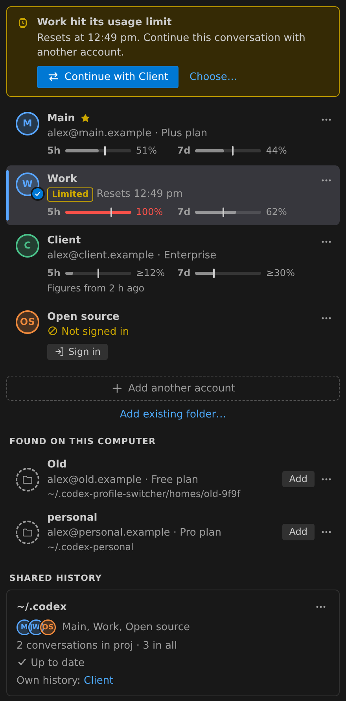

# Codex Profile Switcher

Keep several Codex (ChatGPT) logins on one machine and give each VS Code window its own. Your work project can run on
one account while a side project runs on another, and you can see how close each one is to its limits.



> This is an independent community project. It is not affiliated with, endorsed by or supported by OpenAI. Codex and
> ChatGPT are trademarks of OpenAI. You need the official Codex extension (`openai.chatgpt`) and your own accounts. Check
> that your use of several accounts fits OpenAI's terms.

## Quick start

1. Click the **Codex Profiles** icon in the Activity Bar. Your existing `~/.codex` login is already listed as **Default**.
2. Choose **Add another account**, name it, and pick shared or separate history. A terminal opens for `codex login`
   (browser, device code or API key). The card fills in by itself once the login succeeds.
3. Point at a card and press **Switch**. Codex changes account when the extension host restarts.

The choice is stored per window, so windows on other folders keep theirs.

## Reading the panel

| You see | It means |
|---|---|
| Colored bar and check mark | The account Codex is using in this window |
| Star | The account a window gets until you choose one |
| After restart | Chosen for this window, waiting for a restart |
| Limited | A usage limit was reached; the reset time is next to it |
| ≥ before a figure | The figure is over 30 minutes old, so the real one may be higher |

Below the accounts you can add a Codex home folder that already exists. **Found on this computer** offers `~/.codex-*`
folders that contain a login, plus accounts you took off the list. **Shared history** summarises who shares `~/.codex` and
flags anything that failed to link.

Open **⋯** or right-click a card for the remaining actions. The panel also works from the keyboard: arrows, Home and End
move, Enter runs the main action for the card, F2 renames, Delete takes an account off the list, and Shift+F10 opens the
menu. All of these commands are available from the Command Palette too.

Taking an account off the list never deletes anything. You get an Undo button, and the folder can be added back later.
Deleting a folder is a separate, confirmed action under **Found on this computer**.

## Usage meters

Each window that Codex reports gets a meter, usually **5h** and **7d**. The bar shows the share used, and the upright
marker shows how far through the window you are. A bar that has passed its marker is burning faster than the window
allows, so the card estimates when the limit would arrive. Click a meter for exact reset times.

Limits and figures come from Codex's own records, so an account's numbers only move when Codex runs a turn on it. API key
logins have no meters.

Codex stores figures in shared conversation files, without saying which account wrote them. The extension works it out
like this:

1. If a window sees a conversation from its own folder grow, the new figures go to that window's account.
2. Failing that, they go to the account that started the conversation, as long as the plan matches.

If two accounts on the same plan work in the same folder at once, a figure can land on the wrong account until the next
turn.

## Running out of quota

When this window's account is limited, a banner suggests the account with the most headroom, and **Choose…** lets you
pick another. Accepting switches the window, restarts the extension host and reopens the newest conversation for this
folder in the Codex panel. If that doesn't work, **Open in Terminal Instead** runs `codex resume`. An account with separate
history receives a copy of that one conversation first.

If nothing else is available, **Remind me** sends one notification when the earliest limit resets. Set `offerContinue` to
`off` to turn off the pop-up.

Codex may refuse a conversation that moves between organizations, such as a personal account and a business workspace.
Start a new conversation in that case.

## Shared or separate history

| Mode | Lives in | What is shared with `~/.codex` |
|---|---|---|
| Default account | `~/.codex` (or `mainCodexHome`) | It is the main home |
| Shared | `~/.codex-profile-switcher/homes/<id>/` | Everything except `auth.json` and `models_cache.json`, through symlinks |
| Separate | The same place, or a folder you added | Settings only: `config.toml`, `AGENTS.md`, `rules`, `skills`, `plugins`, `prompts`, `.env` |

**Change History Sharing…** moves an account between modes. Its private history waits in `.isolated-data/` while it
shares and comes back afterwards. No window may be using the account during the change.

## How it works

The official extension starts `codex app-server` from the extension host's environment, and `CODEX_HOME` selects the
login. This extension activates early and sets that variable for the window and its new terminals. That's why a switch
needs an extension host restart, which also restarts the window's other extensions.

If `chatgpt.cliExecutable` is set, or another Codex account switcher is active, the panel warns you, because either one can
override the choice.

## Shell launchers

**Install Shell Launchers…** (panel title bar **⋯**) writes one command per account, such as `codex-work`, for bash, zsh,
sh or fish. Your startup file is backed up first, and running it again replaces the block instead of adding another.

## Settings

| Setting | Default | Purpose |
|---|---|---|
| `codexProfileSwitcher.mainCodexHome` | `~/.codex` | Home of the Default account and of shared history |
| `codexProfileSwitcher.codexPath` | bundled CLI | Codex binary for login and resume |
| `codexProfileSwitcher.restartAfterSwitch` | `ask` | `ask`, `always` or `never` |
| `codexProfileSwitcher.colorStatusBar` | `true` | Tint the status bar entry |
| `codexProfileSwitcher.showUsage` | `true` | Show meters |
| `codexProfileSwitcher.usageInStatusBar` | `auto` | `auto`, `always` or `off` |
| `codexProfileSwitcher.offerContinue` | `ask` | `ask` or `off` |

Override the account colors per theme through `workbench.colorCustomizations`, for example `"codexProfiles.blue"`.

## Privacy

- The extension sends no telemetry and makes no network requests of its own. `codex login` and Codex itself talk to OpenAI
  as usual.
- It reads each account's `auth.json` and decodes the ID token on your machine to show the e-mail and plan and to match
  usage to an account. Access and refresh tokens are not used, and tokens are not logged or copied elsewhere.
- **Import Existing Login** is the exception: at your request, it copies a whole `auth.json` into a new account folder.
- It reads conversation files for their metadata and rate-limit records. Rate-limit records are cached in
  `~/.codex-profile-switcher/usage.json`.

## Requirements and limits

- VS Code 1.94 or later, with the official Codex extension.
- Tested on Linux, including VS Code Remote SSH. macOS should work but is untested. Windows is not supported, because
  shared history needs symlinks and terminals are set up with POSIX shell syntax.
- It relies on Codex internals that are not a public API: the conversation file format, `CODEX_HOME` handling and the
  panel's deep link. A Codex update can break the meters or reopening a conversation.
- If Codex replaces a linked file with a new one, that file stops being shared. The panel flags this and **Show Log** names
  the file.

## Building

```
npx @vscode/vsce package --no-dependencies
```

`python3 build_vsix.py` makes a local package without Node tooling.

## License

[MIT](LICENSE)
